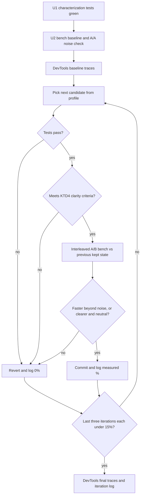

# Class List Benchmark and Optimization Loop - Plan

## Goal Capsule

- **Objective:** Apps that render many Font Awesome icons spend measurably less main-thread time building icon class lists. A repeatable benchmark shows by how much, and the class-list code is no harder to read than it is today.
- **Means:** A committed Node benchmark gates a measured iteration loop on `src/utils/get-class-list-from-props.ts` (KTD1, KTD2, KTD3). Chrome DevTools MCP traces corroborate the result in a real browser (KTD5).
- **Authority:** Product Contract Key Decisions and Requirements, then KTDs, then unit Approach text.
- **Stop conditions:** Done when the R4 stop rule fires. A candidate that changes returned output (R6) is reverted like any other test failure. Never keep one by editing or loosening tests.
- **Execution profile:** One branch, one PR. U1 and U2 land before any optimization. Each kept U3 iteration is its own commit, so the loop reads from git history.
- **Who finishes:** `ce-work` implements and verifies. The calling pipeline opens the PR, and the PR description carries the iteration log (R8).

---

## Product Contract

### Summary

Add a benchmark suite for `getClassListFromProps` and `withPrefix`, and lock current output with characterization tests. Then optimize in measured iterations until three consecutive iterations each improve the headline figure by less than 15%. Browser traces taken before and after show how much of an icon-heavy page's render time the function accounts for.

### Problem Frame

`FontAwesomeIcon` calls `getClassListFromProps` on every render of every icon (`src/components/FontAwesomeIcon.tsx`). The function destructures 31 props and runs about 35 sequential conditionals that push onto an array. When a custom CSS prefix is configured, it also maps every class through `withPrefix`, which builds a new `RegExp` for each class. On a page with hundreds or thousands of icons, that cost repeats on every render.

Earlier commits (`152d0dc`, `08a87fd`, `7b5e00c`, `67ff91c`) optimized this path without a benchmark. There is no baseline to show whether the remaining cost matters or whether a given change helps.

### Key Decisions

- **Stop after three consecutive sub-15% iterations.** Governs R4. (session-settled: user-directed — chosen over a fixed iteration count or stopping at the first plateau: the user's explicit termination rule)
- **Readability outranks speed.** Governs R5. (session-settled: user-directed — chosen over maximizing throughput regardless of readability: the user said not to adopt "crazy code structures just for the sake of performance")
- **A committed, reusable benchmark suite judges every iteration.** Governs R1, R2. (session-settled: user-directed — chosen over one-off ad-hoc profiling with no committed measurement: the user asked to design or evolve a test suite that measures current performance)

### Requirements

**Measurement**

- R1. A committed benchmark suite measures `getClassListFromProps`, including the custom-prefix path through `withPrefix`, across the scenario set in KTD2. One npm script runs it, and `npm test` does not.
- R2. The suite reports time per call for each scenario plus one headline figure, and back-to-back runs on unchanged code agree closely enough that a 15% change is unambiguous (KTD3).

**Optimization loop**

- R3. Each iteration's headline change against the previous kept state is measured and recorded, starting from a recorded baseline.
- R4. The loop ends when three consecutive iterations each improve the headline by less than 15% over the state before them.
- R5. A change is kept only if the resulting code is at least as clear as before, judged by KTD4.

**Behavior**

- R6. For every input, `getClassListFromProps` and `withPrefix` return exactly what they return today. That covers class order, `className` token handling (including `fa-` tokens rewritten under a custom prefix and empty tokens from repeated spaces), flip/size/rotation/pull mapping, null and undefined handling, and v7-only classes being omitted on pre-v7 svg-core.

**Corroboration and record**

- R7. Chrome DevTools MCP traces of a page rendering many icons, taken at baseline and after the final iteration, report the function's self time and its share of scripting time.
- R8. The PR carries an iteration log and the R7 findings. Each log row gives the change attempted, the headline figure, the % change versus the previous kept state, and whether it was kept or reverted, with the reason.

### Success Criteria

- The R4 stop rule was met, and every iteration appears in the R8 log.
- The total headline improvement from baseline to final is reported as measured, including when it is small.
- The R7 traces either confirm the Node result or show where browser and Node results differ.

### Scope Boundaries

- The rest of the icon render path stays unchanged: `faIcon` from svg-core, `makeReactConverter`, and the prop-copy loop in `FontAwesomeIcon`.
- Public props, class names, and exports stay as they are.
- Considered and not built: a CI performance gate. Microbenchmark timings on shared CI runners are too noisy for a 15% threshold. A dedicated, stable perf runner would change this call.
- Considered and not built: a committed browser benchmark page. Bundling React for a browser page adds a build step this repo does not have, and the PR's trace write-up covers R7. Recurring need for browser profiling would change this call.

#### Deferred to Follow-Up Work

- Hotspots outside this function that the R7 traces surface. File them as follow-ups rather than addressing them here.

---

## Planning Contract

### Key Technical Decisions

- KTD1. **Run benchmarks through Jest with a dedicated config.** A new `jest.bench.config.ts` reuses the ts-jest ESM preset from `jest.config.ts`. It matches only `*.bench.ts` files under `__benchmarks__/`, uses the `node` environment, turns coverage off, and runs in band; `npm run bench` invokes it. Jest's default `testMatch` does not match `*.bench.ts`, so `npm test` is unaffected. This adds no dependency and resolves the module's TypeScript and svg-core imports exactly as the tests do. Vitest bench was rejected because it would add a second test runner. Running the file directly with Node was rejected because native type stripping cannot resolve the repo's extensionless relative imports. Coverage stays off because V8 coverage instrumentation changes JIT behavior.
- KTD2. **Fixed scenario set, with the geometric mean as the headline.** Scenario props mirror what `FontAwesomeIcon` really passes: its `DEFAULT_PROPS` merged with user props, so every known key is present and most are `false`. The bench builds its own copy of that defaults object rather than exporting `DEFAULT_PROPS` from the component.
  1. Plain: defaults only. This is the dominant case on icon-heavy pages.
  2. Styled: defaults plus `size`, `fixedWidth`, and a one-token `className`.
  3. Animated: defaults plus `spin`, `pull`, `rotation`, `flip: 'both'`, and a three-token `className`.
  4. Everything: every boolean prop true plus `size`, `rotation`, and `pull`. This is the worst case.
  5. Custom prefix: alternates the styled and animated props with `config.cssPrefix` set.
  6. Page mix: a pre-built array of about 1,000 prop objects, roughly 80% plain, 15% styled, and 5% animated. Each object is built by spreading user props over the defaults, the way `FontAwesomeIcon` merges them, so known keys keep the defaults' order. Shape variety comes from a minority of objects whose user props add non-default keys the component forwards, such as `style`, `color`, or `onClick`, which land at the end of the object.

  The headline is the geometric mean of the per-scenario median ns per call. The ratio of two states' headlines equals the geometric mean of their per-scenario speedups, so a targeted win such as the custom-prefix path counts without one scenario dominating. Improvement is `previous headline / candidate headline − 1`, so a 15% improvement means the candidate takes 1/1.15 of the previous time.

- KTD3. **Measurement protocol.** The harness warms up, then takes many timed samples of a fixed batch of calls using `performance.now()`. It reports median ns per call and sample spread, and feeds results into a sink so V8 cannot eliminate the calls. Before the loop, an A/A comparison (unchanged code measured twice) establishes noise; if headline noise exceeds about 5%, raise batch or sample counts until it does not. Each iteration compares candidate and previous kept state with interleaved runs (A, B, A, B, A, B) in one sitting on one machine, using the median of each side. The harness is a small helper inside the bench file, with no dependency.
- KTD4. **Clarity criteria for keeping a change.** Keep a change only if the code it leaves is at least as clear as the previous kept state (R5) and it uses none of these patterns: manual unrolling, bit-flag encodings, generated or `eval`'d code, any cache needing invalidation beyond a single memo keyed by the current prefix, or duplicated code paths per svg-core version. A faster change that is less clear is reverted and logged. A clearer change that is performance-neutral within noise may be kept; replacing the run of boolean `if`/`push` lines with an ordered prop-to-class table is one example.
- KTD5. **DevTools MCP corroborates; the Node suite gates.** Browser traces are too noisy and manual to decide a 15% threshold run over run, so they give real-page context instead. A scratch page outside the repo renders about 2,000 `FontAwesomeIcon` instances using the page-mix props, against production builds of the library and React. It then re-renders the grid 50 times through parent state updates, so each trace collects enough profiler samples. At baseline and after the final iteration, take two traces with identical settings: one with the default prefix, and one with `config.cssPrefix` set to a custom value before mount. The write-up reports `getClassListFromProps` self time summed over the re-renders from the default-prefix trace, `withPrefix` self time from the custom-prefix trace, and each one's share of scripting time. Self time below a few profiler samples is reported as unresolved, not as a change.
- KTD6. **Keep reading the version flag and prefix on every call.** The pre-v7 tests spy on `constants.getIsVersion7OrLater`, and `CustomPrefixProvider` sets `config.cssPrefix` at runtime, so neither value can move to module scope. Memoizing derived data keyed by the prefix value read on each call is allowed.

### High-Level Technical Design

The iteration loop and its stop rule:

### Assumptions

- An iteration is one candidate change judged against the previous kept state. A reverted or rejected candidate counts as an iteration with 0% improvement and advances the stop counter.
- "Run over run" compares each iteration with the kept state immediately before it, not with the original baseline.
- The benchmark and traces target svg-core v7, the installed dev dependency, because v7 exercises every branch. The pre-v7 branch stays covered by the existing spy-based tests and the CI matrix.
- "A page with a lot of icons" is modeled as mostly plain icons with a minority of styled and animated ones (KTD2 scenario 6).
- A preliminary measurement against the current build put the default-prefix path at about 14–45 ns per call, roughly 0.2% of one icon's ~6 µs render. It put the custom-prefix path at about 550 ns per call, because of per-class `RegExp` construction. The U2 baseline confirms or corrects these figures. The R8 write-up reports gains per scenario and states the app-level share R7 measures, without claiming page-level savings the traces do not show.
- Starting candidates, ordered by what the baseline profile shows rather than by this list:
  - cache the custom-prefix `RegExp`, or skip it for tokens that cannot need rewriting
  - read the prefix once per call instead of once per class
  - replace the boolean `if`/`push` run with an ordered table
  - add `className` tokens without `split` plus spread

### Risks

| Risk                                                                                  | Mitigation                                                                                                                                  |
| ------------------------------------------------------------------------------------- | ------------------------------------------------------------------------------------------------------------------------------------------- |
| Noise near 15% makes the stop rule fire early or late                                 | A/A check and interleaved medians (KTD3)                                                                                                    |
| Microbenchmark JIT behavior differs from a real page (uniform vs mixed object shapes) | Page-mix scenario built the way the component merges props, with forwarded extra keys supplying shape variety (KTD2); browser traces (KTD5) |
| The function is a small share of real render time, so gains matter little in practice | R7 reports the share as measured                                                                                                            |
| An optimization changes output for an input no test pins                              | U1 lands before any optimization (R6)                                                                                                       |

---

## Implementation Units

### U1. Characterization tests for class-list output

**Goal:** Pin current output of `getClassListFromProps` and `withPrefix` so no optimization can change behavior unnoticed.

**Requirements:** R6

**Dependencies:** None

**Files:**

- `src/utils/__tests__/get-class-list-from-props.test.ts` (modify)

**Approach:**

- Add cases only where existing tests leave output unpinned: ordering across all categories, `className` edge cases, prefix switching, and default-props-shaped input. Leave existing assertions as they are.
- Add teardown to the existing pre-v7 `describe` block that restores the `getIsVersion7OrLater` spy and resets the prefix config. The repo's `clearMocks` setting keeps the spy's mocked return value alive, and that block's last test leaves `config.cssPrefix` set, so without teardown both leak into any case defined after it.
- Reuse `resetPrefixConfig` and the existing `jest.spyOn(constants, 'getIsVersion7OrLater')` pattern.
- Gate expectations that depend on v7 (v7-only classes, custom-prefix rewriting) on `IS_VERSION_7_OR_LATER`, as the existing tests do, so the suite also holds under the svg-core v6 CI matrix.

**Execution note:** Write these against the current implementation and confirm they pass before any optimization lands. They describe today's behavior, not new behavior.

**Patterns to follow:** The existing `describe` / `test.each` structure and exact-array `toStrictEqual` assertions in the same file.

**Test scenarios:**

- `className: 'a b'` with `beat`, `fixedWidth`, `flip: 'both'`, `size: 'lg'`, `rotation: 90`, `pull: 'left'`, `swapOpacity`, `rotateBy`, `wag` → exactly `['a', 'b', 'fa-beat', 'fa-fw', 'fa-flip-horizontal', 'fa-flip-vertical', 'fa-lg', 'fa-rotate-90', 'fa-pull-left', 'fa-swap-opacity', 'fa-rotate-by', 'fa-wag']`.
- `className: 'a  b'` (two spaces) → `['a', '', 'b']`.
- `className: 'a '` (trailing space) → `['a', '']`.
- Input shaped like the component's merged defaults (every boolean `false`, `className: ''`, `size`/`rotation`/`pull` undefined) → `[]`.
- `rotation: 0` → no rotate class.
- `flip: false` → no flip classes.
- `config.cssPrefix = 'custom'` with `className: 'fa-foo bar'` and `spin` → `['custom-foo', 'bar', 'custom-spin']`.
- `config.cssPrefix = 'custom'` with `className: 'xfa-foo foo-fa-bar'` → both tokens unchanged.
- `config.cssPrefix = 'custom'` with a `className` token holding a tab, `'a\tfa-b'` → `'a\tcustom-b'`, matching today's whitespace-aware rewrite.
- Prefix switching across calls: `cssPrefix` `'one'`, then `'two'`, then `''`, each with `spin` → `['one-spin']`, `['two-spin']`, `['fa-spin']`.

**Verification:** New and existing tests pass against the unmodified implementation.

### U2. Benchmark suite

**Goal:** `npm run bench` measures the KTD2 scenarios with the KTD3 protocol and prints per-scenario results and the headline.

**Requirements:** R1, R2

**Dependencies:** None (may land alongside U1)

**Files:**

- `jest.bench.config.ts` (create)
- `src/utils/__benchmarks__/get-class-list-from-props.bench.ts` (create)
- `package.json` (add a `bench` script)
- `jest.config.ts` (add `__benchmarks__` to `coveragePathIgnorePatterns` so bench files do not appear as uncovered source)
- `DEVELOPMENT.md` (add `bench` to the task table, plus one line on comparing two states)

**Approach:**

1. The bench config spreads the ts-jest preset the same way `jest.config.ts` does and overrides only what KTD1 lists.
2. The bench file holds the scenarios, a small timing helper, and one `test` per scenario. Each test also asserts the scenario's output equals its expected class list, so the bench never times a broken function and the `jest/expect-expect` lint rule stays satisfied.
3. Output is a compact table (scenario, median ns per call, spread) followed by the headline.
4. The custom-prefix scenario restores `config.cssPrefix` afterwards so scenario order cannot leak state.

**Patterns to follow:** Preset usage in `jest.config.ts`; test layout in `src/utils/__tests__/`.

**Test scenarios:**

- Each scenario's output assertion matches its expected list. For example, Plain → `[]`, and Custom prefix with animated props → prefixed classes in U1's order.
- `npm test` does not pick up the bench file.
- After the custom-prefix scenario, `config.cssPrefix` holds its previous value.

**Verification:** `npm run bench` prints all six scenarios and the headline. Two back-to-back runs on unchanged code agree within the KTD3 noise band. `npm test`, `npm run lint`, and `npm run validate-types` pass with the new files present.

### U3. Measured optimization iterations

**Goal:** Improve the headline in iterations until the stop rule fires, keeping only clear, behavior-preserving changes.

**Requirements:** R3, R4, R5, R6, R7, R8

**Dependencies:** U1, U2

**Files:**

- `src/utils/get-class-list-from-props.ts` (modify)
- `src/utils/constants.ts` (modify only if a kept iteration moves class tables)
- `src/utils/__tests__/get-class-list-from-props.test.ts` (modify only if an iteration adds a helper with its own contract)

**Approach:**

1. Record the baseline: bench headline and per-scenario figures, the A/A noise figure, and the DevTools baseline traces (KTD5).
2. Loop as the High-Level Technical Design shows: one candidate per iteration, checked by tests, then by KTD4, then by an interleaved A/B bench (KTD3) against the previous kept state.
3. Commit each kept iteration separately, with its measured headline change in the commit body. Revert rejected candidates completely.
4. Once R4 fires, take the final DevTools traces with the same page and settings as the baseline, and assemble the R8 log.

**Execution note:** Let the baseline profile choose the first candidate instead of following the Assumptions list in order.

**Technical design:** Directional, not a commitment. A table-driven variant would hold an ordered list of prop-name / class-name pairs for the base boolean flags, iterate it once and push each class whose prop is truthy, then do the same with a second list for v7+ flags after the version check. Flip, size, rotation, and pull keep explicit branches because their mapping is not boolean.

**Test scenarios:**

- U1's characterization tests and the existing tests pass after every kept iteration.
- If an iteration adds a prefix-keyed memo, the U1 prefix-switching scenario still passes, and `withPrefix` still rewrites multi-token strings the way `FontAwesomeLayers` uses it (existing `withPrefix` tests).
- Under the pre-v7 spy, v7-only classes stay absent and custom prefixes stay unapplied (existing tests).

**Verification:** The R8 log shows the stop rule met. Every kept commit passes the Verification Contract gates. The final diff contains no abandoned-candidate code.

---

## Verification Contract

| Gate                            | Command                                                                                | Applies to                                  |
| ------------------------------- | -------------------------------------------------------------------------------------- | ------------------------------------------- |
| Unit tests (svg-core v7)        | `npm test`                                                                             | U1, U2, every kept U3 iteration             |
| Lint                            | `npm run lint`                                                                         | U1, U2, U3                                  |
| Formatting                      | `npm run format:check`                                                                 | U1, U2, U3                                  |
| Types                           | `npm run validate-types`                                                               | U2, U3                                      |
| Benchmark                       | `npm run bench`                                                                        | U2; U3 baseline, A/A check, every iteration |
| Browser corroboration           | Chrome DevTools MCP performance traces of the scratch page (default and custom prefix) | U3 baseline and final                       |
| svg-core v6 and React 18 matrix | CI `build-and-test` job                                                                | PR                                          |

`npm run test:prepublish` exercises svg-core v6 locally but reinstalls packages. Leave it to CI unless an iteration touches the version branch.

---

## Definition of Done

- U1 tests pass against both the original and the final implementation.
- `npm run bench` exists, is documented in `DEVELOPMENT.md`, and is not run by `npm test`.
- The R4 stop rule fired, and the R8 log lists every iteration, kept or reverted.
- Baseline and final DevTools trace findings (R7) are written up for the PR.
- All Verification Contract gates pass on the final commit.
- No experimental or abandoned-candidate code remains in the diff, and no scratch browser page is committed.
